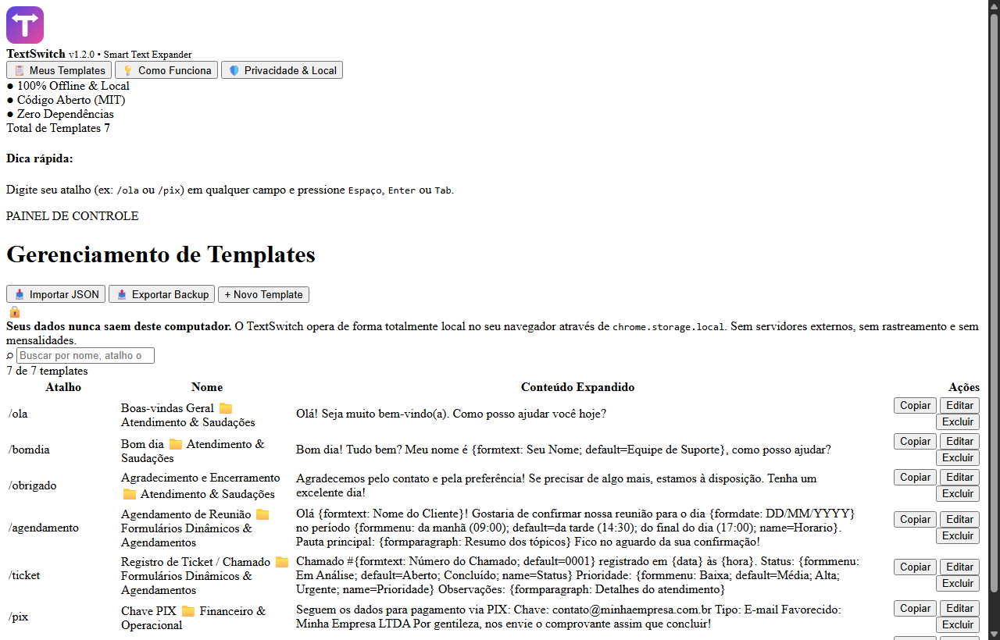
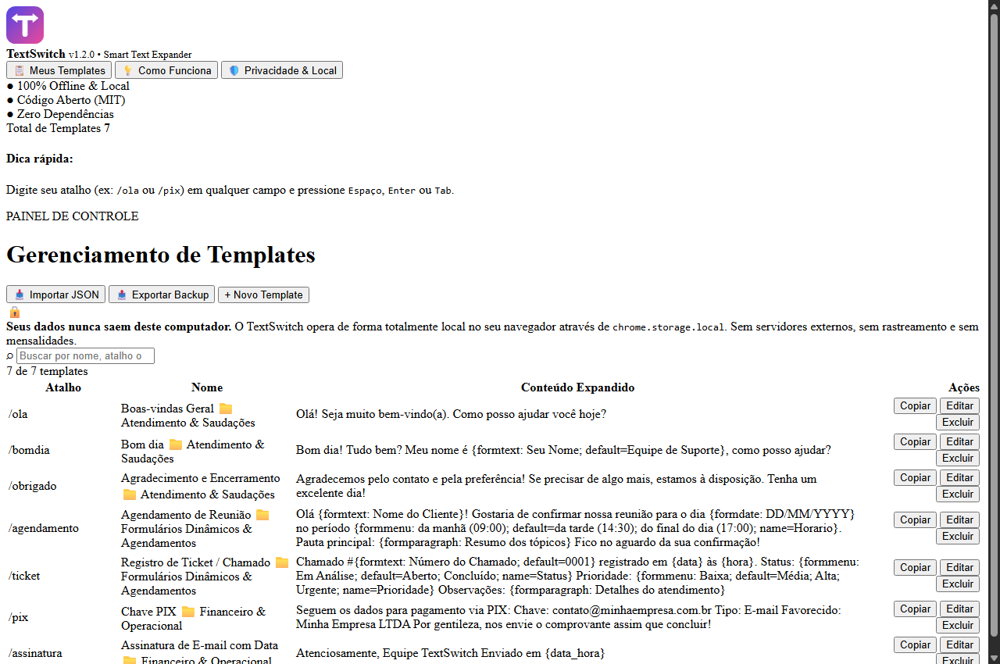
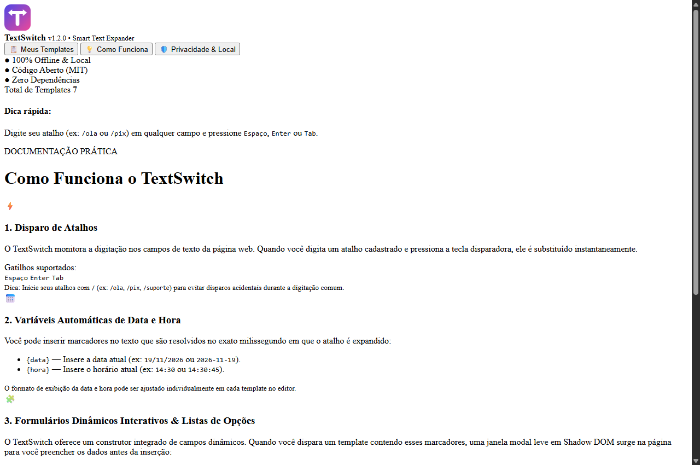
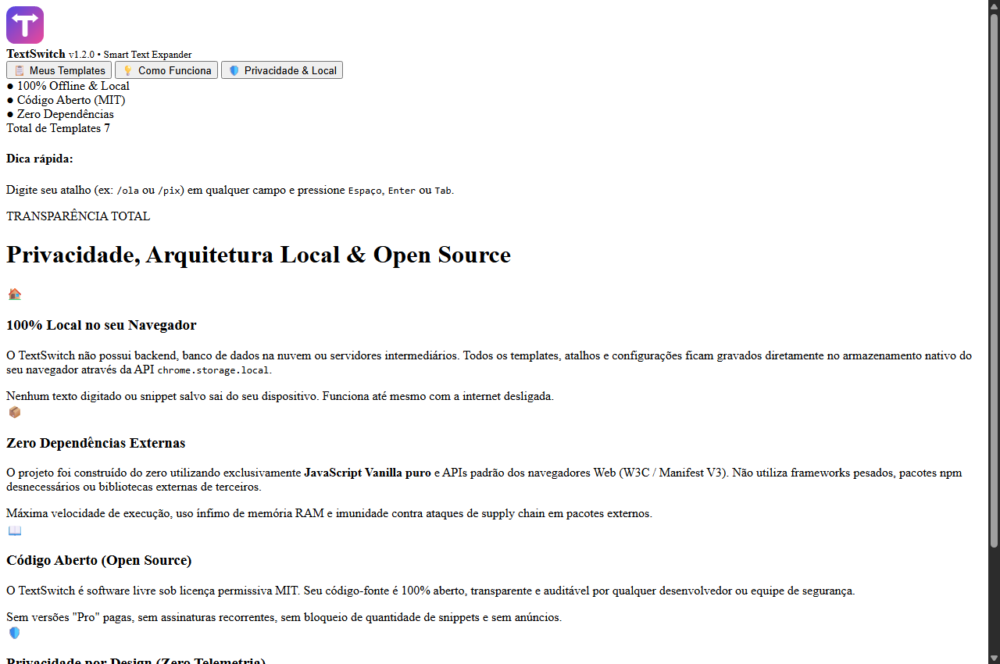
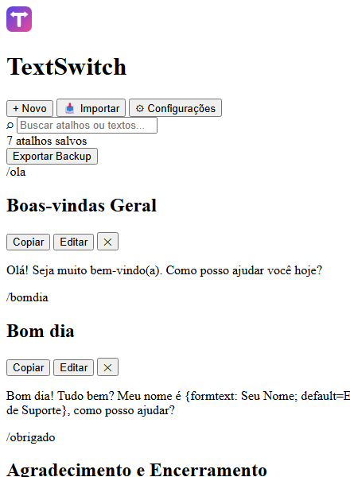

# ⇄ TextSwitch — Smart Text Expander

> **Expanda textos, respostas rápidas e templates dinâmicos instantaneamente no Google Chrome através de atalhos inteligentes.**

O **TextSwitch** é uma extensão aberta, leve, 100% local e focada em privacidade, projetada como uma alternativa robusta e rápida em comparação a outras ferramentas. Funciona em qualquer campo de texto na web (Gmail, WhatsApp Web, Jira, Zendesk, Notion, editores ricos e formulários padrão).

---

## 🤖 Projeto de Estudo & Engenharia de Software com IA

Este projeto foi idealizado e desenvolvido como um **projeto de estudo em engenharia de software**, com foco em:
- **Clean Architecture & Clean Code**: Separação clara de responsabilidades entre regras de negócio puras (`shared/templates.js`), persistência assíncrona (`shared/storage.js`), UI de popup, opções e injeção em páginas (`content.js`).
- **Arquitetura Chrome Manifest V3**: Aderência completa aos novos padrões do ecossistema Chrome Extensions, com permissões mínimas e seguras (`storage`, `activeTab`), sem scripts inline e sem dependências de frameworks pesados.
- **Desenvolvimento Assistido por Inteligência Artificial**: Criado com auxílio de Inteligência Artificial generativa, utilizada como parceira de engenharia no refinamento arquitetural, refatoração de código legado, criação de testes unitários automatizados, geração de documentação e concepção da identidade visual/SVG.
- **Zero-Dependency Vanilla Web**: Demonstração de como construir interfaces reativas e modais ricas utilizando apenas HTML5, CSS moderno (CSS Grid, Flexbox, custom properties) e Vanilla JS nativo.

---

## 📸 Telas da Extensão

### 1. Painel de Gerenciamento de Templates
Visão geral dos atalhos cadastrados, com busca instantânea, estatísticas e atalhos rápidos de edição, exclusão e visualização de conteúdo.



---

### 2. Editor de Templates com Construtor de Variáveis e Menus
Crie snippets com inserção rápida de data, hora, campos de texto e listas dropdown (`{formmenu}`). Permite testar a pré-visualização e disparadores de tecla com precisão.



---

### 3. Guia de Funcionamento e Sintaxe de Variáveis
Aba explicativa completa com passo a passo de como disparar os atalhos em qualquer campo web e a documentação detalhada de cada token dinâmico.



---

### 4. Transparência, Privacidade e Arquitetura 100% Local
Garantia de que nenhum dado trafega pela rede: todo o armazenamento e processamento acontecem exclusivamente na máquina do usuário via `chrome.storage.local`.



---

### 5. Popup Rápido de Acesso
Acesse seus atalhos com 1 clique na barra do navegador, faça pesquisas instantâneas, arraste arquivos JSON para importação ou abra a tela cheia de configurações.

<div align="center">
  
</div>

---

## 🛡️ Privacidade, Zero Dependências e Open Source

- **100% Local no Navegador**: O TextSwitch não envia nenhum dado ou texto para servidores externos. Todo o armazenamento é mantido localmente na máquina do usuário através de `chrome.storage.local`.
- **Zero Rastreamento (No Telemetry)**: Sem Google Analytics, sem Mixpanel, sem rastreadores e sem coleta de métricas de digitação.
- **Zero Dependências Externas**: Desenvolvido exclusivamente em JavaScript Vanilla e APIs nativas da plataforma Web do Chrome, garantindo máxima performance, leveza de memória e imunidade contra vulnerabilidades de supply chain.
- **Código Aberto (MIT)**: Software livre, auditável e sem pegadinhas. Sem assinaturas, sem limites de snippets e sem planos pagos para uso de formulários dinâmicos.

---

## 🎨 Identidade Visual e Logo

O TextSwitch traz uma identidade visual moderna com paleta de gradiente vibrante (Indigo `#4f46e5` para Coral/Pink `#ec4899`) e o monograma **T** integrado ao switch de setas bidirecionais `⇄`.

- **Ícones inclusos**:
  - `src/icon.svg`: Ícone vetorial master em alta definição.
  - `src/logo.svg`: Logo horizontal com tipografia oficial.
  - `src/icons/icon-16.png`: 16×16 px (menu e favicon).
  - `src/icons/icon-32.png`: 32×32 px (barra do navegador e monitores Retina).
  - `src/icons/icon-48.png`: 48×48 px (painel de extensões).
  - `src/icons/icon-128.png`: 128×128 px (instalação e Web Store).

---

## 🚀 Principais Recursos

- **Expansão Instantânea**: Digite seu atalho (ex.: `/ola`, `/pix`, `/suporte`) e pressione <kbd>Espaço</kbd>, <kbd>Enter</kbd> ou <kbd>Tab</kbd> para disparar o template.
- **Campos Dinâmicos Interativos**: Suporte completo a tags dinâmicas do Text Blaze:
  - `{formdate: DD/MM/YYYY}`: seletor de data visual nativo.
  - `{formmenu: Opção A; default=Opção B; Opção C}`: menu dropdown com opções predefinidas.
  - `{formtext: Nome}`: campo de texto de linha única.
  - `{formparagraph: Detalhes}`: área de texto multilinha.
- **Variáveis Automáticas**: Inserção inteligente de `{data}`, `{hora}` e `{data_hora}` com formatos configuráveis por template.
- **Importação Confiável em Dois Modos**:
  - **No Popup**: Botão **📥 Importar** com abertura imediata da tela de importação em aba dedicada (evita que o Chrome feche o popup) + suporte a **Drag & Drop** (arraste seu arquivo `.json` diretamente para dentro do popup).
  - **No Painel de Configurações**: Seletor nativo com relatório de importação em tempo real (compatível com Text Blaze, formato nativo, listas e dicionários).
- **Acesso Direto às Configurações**:
  - Botão **⚙ Configurações** no topo do popup.
  - Link amplo no rodapé do popup: **"⚙ Abrir Painel Completo de Configurações"**.
  - Clique com o botão direito no ícone do Chrome -> **Opções**.
- **Backup e Exportação**: Exporte seus templates a qualquer momento em JSON com 1 clique (`textswitch-backup-AAAA-MM-DD.json`).

---

## 📁 Arquitetura do Projeto

```
extensão/
├── .gitignore              # Regras de exclusão do Git
├── README.md               # Documentação técnica, telas e guia de instalação
├── package.json            # Scripts npm ("build" e "test")
├── build.js                # Script de compilação e validação do manifest.json
├── docs/                   # Documentação visual do projeto
│   └── screenshots/        # Capturas de tela da extensão em alta resolução
├── examples/               # Exemplos e fixtures de importação universais
│   └── text-blaze-sample.json
├── scripts/                # Scripts utilitários de desenvolvimento
│   └── capture-screenshots.js # Automação headless do Chrome para capturar telas
├── src/                    # Código-fonte da extensão
│   ├── manifest.json       # Manifesto Chrome V3 devidamente configurado
│   ├── icon.svg            # Ícone vetorial master
│   ├── logo.svg            # Logo horizontal completo
│   ├── icons/              # Pacote de ícones PNG em múltiplas resoluções
│   │   ├── icon-16.png
│   │   ├── icon-32.png
│   │   ├── icon-48.png
│   │   └── icon-128.png
│   ├── content.js          # Injetado nas páginas para escutar e expandir atalhos
│   ├── shared/             # Lógica de domínio e persistência compartilhada
│   │   ├── templates.js    # Funções puras: normalização, tokens, parsing e busca
│   │   └── storage.js      # Camada de persistência Chrome Storage com Promises
│   ├── popup/              # Interface do popup na barra de ferramentas
│   │   ├── popup.html
│   │   ├── popup.css
│   │   └── popup.js
│   └── options/            # Painel administrativo e documentação em abas
│       ├── options.html
│       ├── options.css
│       └── options.js
├── tests/                  # Testes unitários automatizados
│   └── templates.test.js
└── dist/                   # Artefato gerado pelo build (carregado no Chrome)
```

---

## 🛠️ Como Instalar no Google Chrome

### 1. Compilar os arquivos da extensão
No terminal, execute:

```bash
npm run build
```

O script validará o manifesto, checará todos os assets e gerará a pasta `dist/`.

### 2. Carregar no navegador
1. Abra o Chrome e vá para `chrome://extensions/`.
2. No canto superior direito, ative a chave **Modo do desenvolvedor**.
3. Clique em **Carregar sem compactação** (ou *Load unpacked*).
4. Selecione a pasta [`dist`](file:///c:/Users/eduar/OneDrive/Documents/GitHub/extens%C3%A3o/dist).
5. O ícone oficial **⇄ TextSwitch** aparecerá na barra de ferramentas do seu Chrome.

---

## 🧪 Testes Automatizados

Execute a suíte de testes unitários:

```bash
npm test
```

Garante 100% de cobertura nas funções críticas de normalização, escape contra XSS, expansão de tokens e importação de modelos.

---

## 📄 Licença

Distribuído sob licença MIT. Livre para uso pessoal e comercial.
